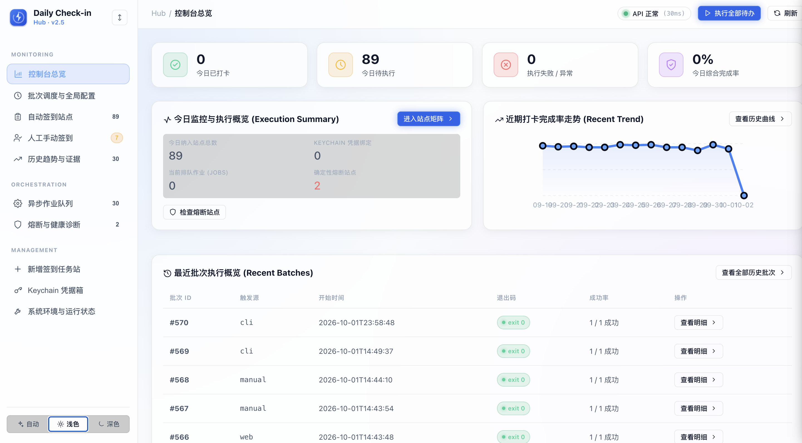

<div align="center">

# DailyCheckin

**Automated Multi-Target Web Attendance, Evidence-Driven Verification & Chrome CDP Session Orchestrator**

[](LICENSE)
[](https://www.python.org/)
[](https://playwright.dev/)
[](https://www.sqlite.org/)
[]()

[English](./README.md) · [简体中文](./README.zh-CN.md) · [Core Features](#core-features) · [Quick Start](#quick-start) · [Site Config](#site-configuration-guide) · [Architecture](#architecture)

<br>



</div>

---

## Architecture & Motivation

Traditional browser automation scripts frequently suffer from fragile session cookies, bot detection challenges, and false-positive confirmations. DailyCheckin solves these failure modes through native Chrome CDP session reuse and double-checked evidence gates:

| Operational Challenge | Conventional Scripts | DailyCheckin Solution |
| :--- | :--- | :--- |
| **Session Invalidation** | Pure HTTP requests trigger rate-limits or cookie expiration | **Chrome CDP Session Reuse**: Bridges to physical desktop Chrome sessions, preserving authenticated states |
| **False Positive Success** | Script reports success immediately after clicking CTA | **Evidence-Driven Gates**: Double-checks strong DOM mutations or response payloads before recording success |
| **High Maintenance Cost** | Requires dozens of custom code lines per web target | **Declarative YAML Specs**: 95% of targets need only a few selector definitions |
| **Modal / Overlay Obstructions** | Promo dialogs and modal backdrops intercept click events | **Overlay Zapper**: Automatically dismantles blocking overlays before dispatching clicks |
| **Credential Storage Risks** | Plaintext secrets stored in repository configuration | **Hardware Isolation**: Secrets persist directly in macOS Keychain with references in SQLite |

---

## Core Features

### 1. Universal Web Check-in
Seamlessly handles modern Single Page Applications (SPAs), developer forums (Linux.do, Discuz), AI inference providers, and cloud management consoles using declarative CSS or text selector configurations.

### 2. Evidence-Driven Verification
Rejects "zero exceptions equals success" heuristics. Every check-in requires cryptographic or DOM confirmation:
- `dom_strong` / `dom_done_state`: Page renders definitive confirmation text or the target button transitions to a disabled state.
- `network_response` / `api_success`: Intercepts background JSON payloads indicating successful check-in actions and balance updates.
- Records `OK` or `ALREADY` only upon capturing verifiable proof; otherwise categorizes exact failure causes (`auth_failed`, `no_confirm`, `selector_missing`).

### 3. Non-Intrusive Chrome CDP Connection
- Bridges directly to Google Chrome via its remote debugging port (`--remote-debugging-port=9222`).
- Creates isolated temporary tabs via `/json/new` and destroys them immediately after task completion without interfering with user browsing sessions.
- Naturally circumvents common bot detection suites, including Cloudflare Turnstile and challenge pages.

### 4. Built-in Web Management Dashboard
- **Zero-Build Architecture**: Modern vanilla Web Components and native CSS variables without requiring complex Node.js build pipelines.
- **Full Operational Control**: Single-target manual execution, one-click batch dispatching, FIFO task queues, retry mechanisms, and Telegram alert integration.

### 5. Ecosystem Integrations
- **Obsidian Task Sync**: Bi-directionally syncs daily task checklists in Obsidian vaults with automated completion checkboxes.
- **Headless Task Schedulers**: Clean single-process exit codes designed for cron jobs and external monitoring probes.

---

## Declarative Site Adaptation

DailyCheckin requires no Python code for standard targets. Configure sites directly in `sites.yaml`:

### Scenario A: Standard Web Application
```yaml
sites:
  - name: 'TechForum'
    url: https://forum.example.com/checkin
    kind: browser
    signs:
      - 'button:has-text("Check-in")'
      - '.checkin-btn'
    already:
      - 'text=Already Checked In'
      - 'text=Come back tomorrow'
      - 'button:disabled'
```

### Scenario B: New API / One API Gateway Profile
```yaml
sites:
  - name: 'ModelGateway'
    url: https://api.example.com/profile
    kind: newapi_profile
```

### Scenario C: Silent API Execution
```yaml
sites:
  - name: 'FastAPIEndpoint'
    url: https://router.example.com/console
    kind: browser
    signin_api: /api/user/sign_in
```

### Scenario D: Custom BaseCheckinProvider Extension
For workflows with non-standard requirements (interactive Canvas mini-games, complex CAPTCHA flows, multi-stage OAuth), subclass `BaseCheckinProvider` to hook into the lifecycle engine.

---

## Quick Start

### 1. Prerequisites

- macOS 12+ (recommended) or Linux
- Python 3.10+
- Google Chrome or Chromium

```bash
# 1. Clone repository
git clone https://github.com/dengyie/daily-checkin.git
cd daily-checkin

# 2. Setup virtual environment
python3 -m venv .venv
source .venv/bin/activate

# 3. Install dependencies
pip install -r requirements.txt
playwright install chromium
```

### 2. Launch Dedicated Chrome Profile

```bash
open -n -a "Google Chrome" --args \
  --remote-debugging-address=127.0.0.1 \
  --remote-debugging-port=9222 \
  --user-data-dir="$HOME/chrome-checkin-profile" \
  --no-first-run \
  --no-default-browser-check
```

Log in to your accounts within the dedicated window. Sessions persist in the isolated user data directory.

Verify debugging connectivity:
```bash
curl -fsS http://127.0.0.1:9222/json/version
```

### 3. Run Check-in Tasks

```bash
# Dry run verification (parses tasks without triggering clicks)
python stealth_checkin_runner.py --dry-run

# Run all enabled check-ins
python stealth_checkin_runner.py

# Run targeted site
python stealth_checkin_runner.py --only "SiteA,SiteB"

# Retry previous failures
python stealth_checkin_runner.py --retry-auto-fail
```

---

## Web Dashboard Console

Launch the decoupled local management console:

```bash
# Start backend API (port 8765)
python -m checkin_core.web --host 127.0.0.1 --port 8765 &

# Start frontend file server (port 8766)
python scripts/serve-frontend.py --host 127.0.0.1 --port 8766 &
```

Navigate to `http://127.0.0.1:8766` to monitor execution queues, drill into verification proofs, and manage notification webhooks.

---

## Site Configuration Guide

### Specification Format (`sites.yaml`)

```yaml
sites:
  - name: 'SampleForum'
    url: https://linux.do/
    kind: browser
    signs:
      - 'button:has-text("Check-in")'
      - '.checkin-action'
    already:
      - 'text=Completed Today'
    ready_rounds: 15
    use_overlay_zapper: true
```

### Configuration Fields

| Field | Type | Description | Default |
| :--- | :---: | :--- | :---: |
| `name` | `string` | Unique site identifier | Required |
| `url` | `string` | Target check-in page URL | Required |
| `kind` | `string` | Provider type (`browser`, `newapi_profile`, `bohe`, etc.) | `browser` |
| `signs` | `list` | Ordered selectors targeting the action CTA button | `[]` |
| `already` | `list` | Text/selectors indicating checked-in state | `[]` |
| `ready_rounds` | `int` | Maximum readiness poll iterations | `15` |
| `use_overlay_zapper` | `bool` | Automatically eliminate modal dialogs | `true` |
| `signin_api` | `string` | In-page background POST API path | `""` |

---

## Architecture

```text
┌────────────────────────────────────────────────────────┐
│               Interface Layer (Web UI / CLI / Cron)    │
└──────────────────────────┬─────────────────────────────┘
                           │
                           ▼
┌────────────────────────────────────────────────────────┐
│             Check-in Dispatch Engine                   │
│  ├─ FIFO Async Queue    ├─ Singleton Process Lock      │
│  ├─ Overlay Zapper      ├─ SSO / OAuth Follower        │
│  └─ Error Classifier    └─ Telegram Notification Hub   │
└──────────────┬───────────────────────────┬─────────────┘
               │                           │
               ▼                           ▼
┌───────────────────────────┐ ┌───────────────────────────┐
│     SQLite (system.db)    │ │   macOS Keychain (Secure) │
│ Metadata / Runs / Proofs  │ │ Hardware Credential Store │
└───────────────────────────┘ └───────────────────────────┘
               │
               ▼
┌────────────────────────────────────────────────────────┐
│             Desktop Chrome Browser (CDP Pool)          │
│  ├─ Reuses Active Session├─ Ephemeral Target Tabs      │
│  ├─ Strict Lifecycle     └─ Undetected Cloudflare Pass │
└────────────────────────────────────────────────────────┘
```

### Exit Codes

| Code | Status | Meaning |
| :---: | :--- | :--- |
| **`0`** | `SUCCESS` | All tasks succeeded, verified as already completed, or dry run finished |
| **`1`** | `BUSINESS_FAIL` | At least one site failed verification or authentication |
| **`2`** | `INFRA_FAIL` | Infrastructure failure (network unreachable, CDP disconnected) |
| **`3`** | `NO_CDP` | Chrome remote debugging port unavailable |
| **`4`** | `LOCKED` | Another execution batch holds the active lock |

---

## Security & Privacy Policies

- **Zero Cloud Leakage**: Runs entirely on local infrastructure with zero telemetry or tracking metrics.
- **Hardware Credential Isolation**: Passwords and tokens persist in macOS Keychain (`com.mango.daily-checkin`), keeping credentials completely out of Git.
- **Loopback Binding**: Services bind strictly to `127.0.0.1` with mandatory Host verification and anti-CSRF protection.

---

## License

Released under the [MIT License](LICENSE).
