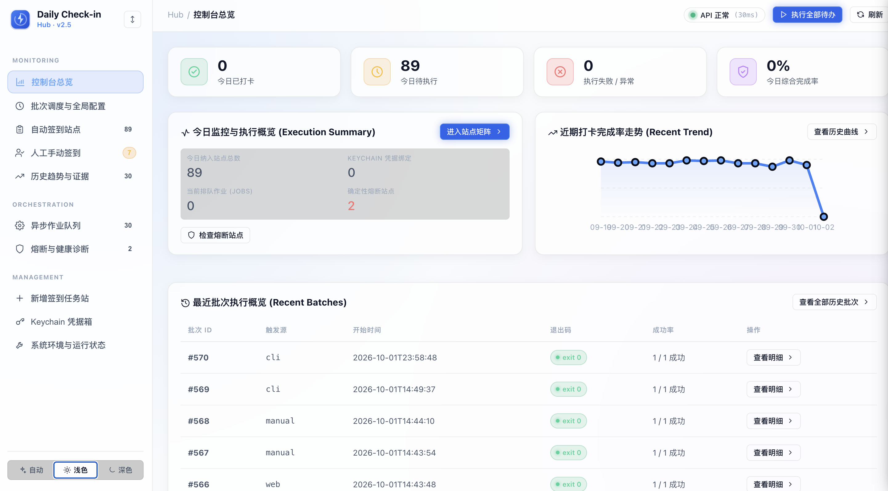

<div align="center">

# DailyCheckin

**泛支持所有现代网页的证据驱动自动化签到系统与 Chrome CDP 会话调度中枢**

[](LICENSE)
[](https://www.python.org/)
[](https://playwright.dev/)
[](https://www.sqlite.org/)
[]()

[English](./README.md) · [简体中文](./README.zh-CN.md) · [核心特性](#核心特性与架构亮点) · [快速上手](#快速上手) · [站点配置](#站点配置与自定义扩展) · [系统架构](#架构与工作原理)

<br>



</div>

---

## 痛点与解决方案

| 传统签到脚本常见痛点 | DailyCheckin 解决方案 |
| :--- | :--- |
| **容易掉登录态**：纯 HTTP 请求频繁被风控拦截或 Cookie 过期 | **复用系统 Chrome CDP**：直接共享浏览器真实会话，免除频繁扫码与验证 |
| **虚假成功 (Fake Success)**：点了按钮就报成功，其实被弹窗挡住或签到失败 | **证据驱动架构 (Evidence-First)**：双重核验 DOM 强状态与响应数据，无实质业务成功绝不误报 |
| **适配成本高**：每个新网站都要写复杂的自动化驱动逻辑 | **声明式 YAML**：95% 网站只需数行选择器配置，通用智能流自动识别 |
| **弹窗遮挡阻断**：全屏广告、活动弹窗遮挡点击事件 | **智能弹窗爆破 (Overlay Zapper)**：自动清理遮罩与阻挡层，精准定位目标 CTA |
| **安全隐患**：明文账号密码写在配置文件中 | **系统级安全隔离**：敏感凭据落入 macOS Keychain 硬件保护，SQLite 仅存引用标识 |

---

## 核心特性与架构亮点

### 1. 泛支持所有网页签到 (Universal Web Check-in)
无论是 New API / One API 中继网关、各类论坛社区（Linux.do、Discuz 等）、AI 平台还是云服务商控制台，只需提供 URL 与声明式 CSS/文本选择器，系统即可自动纳管。

### 2. 严格的业务证据驱动 (Evidence-Driven Verification)
拒绝仅凭未报错判定签到成功。签到动作执行后，系统启动证据采集闭环：
- `dom_strong` / `dom_done_state`: 页面出现“今日已签到”、“明日再来”或签到按钮状态变更为 disabled。
- `network_response` / `api_success`: 捕获到底层签到接口成功回包与积分增长。
- 只有真实捕获到确定性证据才判定 `OK` / `ALREADY`，否则精准归类失败原因（如 `auth_failed`, `no_confirm`, `selector_missing` 等）。

### 3. 真正的无感 CDP 会话复用 (Headless-Proof)
- 自动连接日常使用的独立 Chrome 调试端口，不主动启动、不暴力关闭主浏览器进程。
- 通过 CDP `/json/new` 创建静默临时标签页，签到完成后立刻安全销毁，不干扰正常浏览体验。
- 原生规避绝大部分自动化检测（Cloudflare Turnstile, WAF, 滑块风控）。

### 4. 开箱即用的前后端控制台
- **零构建运行时**：内置无构建轻量前端（原生 Modern Web Components + CSS 变量，无需 `npm install` 或复杂的 Node 构建环境）。
- **完整交互能力**：支持单站即时调试、全站一键调度、实时 FIFO 任务队列、失败重试、健康熔断诊断、运行证据下钻与 Telegram 告警配置。

### 5. 丰富的生态联动
- **Obsidian 任务联动**：双向同步 Obsidian 每日任务清单，执行结果自动打勾投影。
- **定时调度与探针接入**：支持单进程优雅退出，契合 Cron 与自动化巡检调度。

---

## 泛网页签到与零代码适配

DailyCheckin 拥有高度抽象的适配引擎，绝大多数网站无需编写任何 Python 代码，只需在 `sites.yaml` 中声明：

### 场景 A：标准现代网页
```yaml
sites:
  - name: '示例技术论坛'
    url: https://forum.example.com/checkin
    kind: browser
    signs:
      - 'button:has-text("立即签到")'
      - '.checkin-btn'
    already:
      - 'text=今日已签到'
      - 'text=明日再来'
      - 'button:disabled'
```

### 场景 B：New API / One API / 大模型中继网关
原生内置 `newapi_profile` 模板，一行搞定全站适配：
```yaml
sites:
  - name: '大模型聚合网关'
    url: https://api.example.com/profile
    kind: newapi_profile
```

### 场景 C：静默 API 签到 / 积分接口
部分站点只需登录态并在控制台静默触发 POST 请求：
```yaml
sites:
  - name: '极速签到站点'
    url: https://router.example.com/console
    kind: browser
    signin_api: /api/user/sign_in
```

### 场景 D：深度定制 Provider
对于具备特殊前置流程（如 Canvas 互动、验证码等待、OAuth 级联跳转）的站点，继承 `BaseCheckinProvider` 即可复用完整的生命周期管理与证据收集能力。

---

## 快速上手

### 1. 环境准备

- macOS 12+ (推荐) 或 Linux
- Python 3.10+
- Google Chrome 或 Chromium

```bash
# 1. 克隆项目仓库
git clone https://github.com/dengyie/daily-checkin.git
cd daily-checkin

# 2. 创建并激活虚拟环境
python3 -m venv .venv
source .venv/bin/activate

# 3. 安装依赖与 Playwright 驱动
pip install -r requirements.txt
playwright install chromium
```

### 2. 启动 Chrome 独立调试会话

```bash
open -n -a "Google Chrome" --args \
  --remote-debugging-address=127.0.0.1 \
  --remote-debugging-port=9222 \
  --user-data-dir="$HOME/chrome-checkin-profile" \
  --no-first-run \
  --no-default-browser-check
```

在打开的浏览器窗口中登录需要签到的账号（会话凭证将自动持久化保留在 profile 中）。

验证调试端口连通：
```bash
curl -fsS http://127.0.0.1:9222/json/version
```

### 3. 执行签到任务

```bash
# 仿真测试（解析任务、加载站点目录，不触发真实点击）
python stealth_checkin_runner.py --dry-run

# 执行所有已启用站点的签到
python stealth_checkin_runner.py

# 仅签到指定站点
python stealth_checkin_runner.py --only "SiteA,SiteB"

# 仅重试上一次失败的站点
python stealth_checkin_runner.py --retry-auto-fail
```

---

## Web UI 控制台

项目自带前后端分离的现代化本地控制台，方便批量管理与实时监控：

```bash
# 启动后端 API（端口 8765）
python -m checkin_core.web --host 127.0.0.1 --port 8765 &

# 启动前端静态服务（端口 8766）
python scripts/serve-frontend.py --host 127.0.0.1 --port 8766 &
```

访问 `http://127.0.0.1:8766`：
- **总览大盘**：实时展示今日成功数、已签数、失败数与队列运行状况。
- **即时调试**：在面板上对任意单站发起即时运行或批量入队。
- **证据回溯**：查看详细的执行动作链（Action）与确认证据（Confirmation）。
- **通知管理**：在线测试与配置 Telegram 机器人推送。

---

## 站点配置与自定义扩展

### 配置文件结构 (`sites.yaml`)

```yaml
sites:
  # 示例 1: 通用网页适配（支持多选择器容错回退）
  - name: '示例论坛'
    url: https://linux.do/
    kind: browser
    signs:
      - 'button:has-text("打卡")'
      - '.checkin-action'
    already:
      - 'text=今日已打卡'
      - 'text=已签到'
    ready_rounds: 15          # 页面加载等待轮数
    use_overlay_zapper: true  # 自动清理活动弹窗

  # 示例 2: New API 标准个人中心
  - name: '我的聚合 API'
    url: https://api.my-domain.com/profile
    kind: newapi_profile

  # 示例 3: 带特殊请求头的签到 API
  - name: '专属节点站'
    url: https://node.example.com/console
    kind: browser
    signin_api: /api/v1/user/checkin
    signin_api_uid_header: true
```

### 字段说明表

| 字段 | 类型 | 说明 | 默认值 |
| :--- | :---: | :--- | :---: |
| `name` | `string` | 站点唯一标识名称 | 必填 |
| `url` | `string` | 签到目标页面完整 URL | 必填 |
| `kind` | `string` | 适配类型 (`browser`, `newapi_profile`, `bohe`, `arkengine` 等) | `browser` |
| `signs` | `list` | 签到按钮的定位选择器（按顺序依次尝试） | `[]` |
| `already` | `list` | 已签到状态的判定选择器/文本 | `[]` |
| `ready_rounds`| `int` | 页面就绪轮询最大次数 | `15` |
| `use_overlay_zapper` | `bool` | 是否在点击前自动消除干扰遮罩层与弹窗 | `true` |
| `signin_api` | `string` | 站点内置静默签到 API 路径 | `""` |

---

## 架构与工作原理

```text
┌────────────────────────────────────────────────────────┐
│               交互层 (Web UI / CLI / Cron)              │
└──────────────────────────┬─────────────────────────────┘
                           │
                           ▼
┌────────────────────────────────────────────────────────┐
│              调度与编排器 (Check-in Engine)             │
│  ├─ FIFO 异步队列       ├─ 单例进程锁 (Singleton Lock)  │
│  ├─ 智能弹窗消除器      ├─ SSO / OAuth 智能跟随         │
│  └─ 失败自动归类分类器   └─ Telegram 告警分发           │
└──────────────┬───────────────────────────┬─────────────┘
               │                           │
               ▼                           ▼
┌───────────────────────────┐ ┌───────────────────────────┐
│     SQLite (system.db)    │ │   macOS Keychain (安全)   │
│ 存储站点元数据/运行批次/证据 │ │ 硬件隔离存储敏感凭据/Token │
└───────────────────────────┘ └───────────────────────────┘
               │
               ▼
┌────────────────────────────────────────────────────────┐
│             真实 Chrome 浏览器 (CDP 会话池)             │
│  ├─ 复用已有登录态       ├─ 静默创建临时 Target          │
│  ├─ 严格生命周期管理     └─ 绕过 Cloudflare / Turnstile  │
└────────────────────────────────────────────────────────┘
```

### 退出状态码规范

| 退出码 | 状态标识 | 含义说明 |
| :---: | :--- | :--- |
| **`0`** | `SUCCESS` | 全部任务正常完成（或均为已签到状态/Dry-run） |
| **`1`** | `BUSINESS_FAIL` | 存在至少一个站点的业务签到失败（如账号失效、未找到确认证据） |
| **`2`** | `INFRA_FAIL` | 基础设施故障（如 CDP 意外断连、网络不可达） |
| **`3`** | `NO_CDP` | 未检测到活跃的 Chrome Remote Debugging 端口 |
| **`4`** | `LOCKED` | 当前已有正在运行的签到批次持有排他锁 |

---

## 安全与隐私准则

- **零数据外发**：本项目纯本地运行，无任何远程遥测或中心化上报，不收集任何用户隐私数据。
- **系统硬件级凭据隔离**：账号、密码与持久化 Token 均直接存入 macOS Keychain（`com.mango.daily-checkin`），数据库仅保存引用标识。
- **本地回环网络限制**：Web 控制台与 API 仅绑定 `127.0.0.1`，严格校验 Host 请求头与防 CSRF 机制，严禁未经认证直接暴露至公网。

---

## 参与贡献与许可证

欢迎提交 Issue 和 Pull Request！
在贡献代码前，请确保自动化回归测试通过：
```bash
python3.12 -m pytest tests/ -q -n auto
```

本项目基于 [MIT License](LICENSE) 协议发布。
